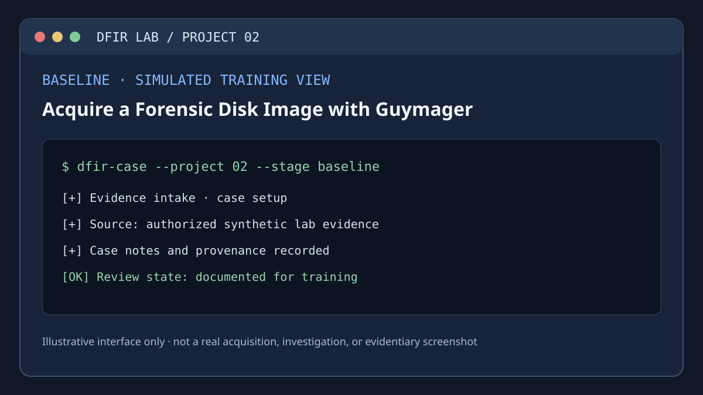

# Project 02: Acquire a Forensic Disk Image with Guymager




## Objective
Build a repeatable DFIR workflow for **acquire a forensic disk image with guymager** and produce defensible, clearly documented results.

## Scope and authorization
Use only a lab workstation and media, disk images, or synthetic artifacts that you own or are explicitly authorized to examine. Do not connect an unknown device to a production endpoint. Preserve original evidence, work from verified copies, and document every transfer and transformation. The illustrations in this README are simulated training visuals, not real forensic screenshots or case evidence.

## Prerequisites
- A dedicated Linux forensic VM (SIFT Workstation or an equivalent analysis environment).
- A disposable test image/device or supplied synthetic artifacts; never experiment on original evidence.
- A case directory with restricted access and sufficient storage.
- Tools: Guymager, Linux, udev, lsblk.
- A notes file recording case ID, examiner, UTC timestamps, tool versions, source identifiers, and actions.

## Lab setup
1. Create a case folder such as `case-DFIR-02` with `evidence/original`, `evidence/working`, `exports`, `notes`, and `reports` subdirectories.
2. Record host name, OS release, tool versions, current UTC time, and examiner identity.
3. Place the authorized test artifact in the original-evidence directory and make the original read-only.
4. Calculate a SHA-256 hash before analysis; retain the output in a separate manifest.
5. Perform analysis on a verified working copy. Do not alter the original.

## Walkthrough
Connect a disposable lab USB device, identify it by model/serial/capacity, acquire a raw or EWF image, record acquisition metadata, and verify the resulting image.

### Step 1 — Establish the case record
Record the case identifier, purpose, authorization reference, evidence source, acquisition method, examiner, date/time (UTC), and known limitations. Use a consistent naming convention for every output.

### Step 2 — Inspect the evidence safely
Identify the artifact type and its size, format, timestamps, and provenance. Confirm that the selected tool supports the format. Capture tool versions and command lines so another examiner can reproduce the process.

### Step 3 — Perform the project workflow
Use the tools listed above to execute the project-specific workflow. Keep commands read-only where possible. Save terminal output and screenshots of the lab interface as working notes; redact personal data and secrets before publishing.

### Step 4 — Preserve findings
For each relevant artifact, record its source path or offset, metadata, hash (where applicable), time zone assumptions, interpretation, and confidence. Separate direct observations from hypotheses.

## Example commands
The following baseline commands help document a Linux forensic workstation. Adapt paths to your authorized lab artifact.

```bash
date -u
uname -a
lsblk -o NAME,SIZE,MODEL,SERIAL,RO,TYPE
sha256sum /path/to/authorized-evidence.img
file /path/to/authorized-evidence.img
```

For a disk-image workflow, additional read-only inspection may include:

```bash
mmls /path/to/authorized-evidence.img
fls -r -p /path/to/authorized-evidence.img
```

Do not run commands against a live production system or untrusted media unless the engagement explicitly authorizes that collection method.

## Expected observations
- A complete case record and reproducible activity log.
- Evidence source and working-copy identifiers that cannot be confused.
- Hashes and metadata sufficient to detect accidental modification.
- Findings linked to a source artifact, path, offset, or event record.
- Explicit notes for missing data, clock drift, parsing errors, and tool limitations.

## Findings and risk assessment
Classify each observation as confirmed, likely, or inconclusive. Explain operational impact and affected assets. Avoid attributing activity to a person based only on a hostname, IP address, username, or isolated timestamp. Record alternative explanations and confidence.

## Framework and artifact mapping
Map relevant observations to the applicable DFIR process (NIST SP 800-61 incident handling lifecycle) and evidence-handling principles. Where a security weakness is identified, map it to a relevant MITRE ATT&CK technique only when the behavior is supported by evidence. Do not force a CWE or OWASP mapping when the finding is not a software weakness.

## Remediation and response
Recommend containment, eradication, recovery, or process improvements only when supported by the evidence and engagement scope. Preserve evidence before remediation. Identify the owner, priority, and validation method for each action.

## Validation
1. Re-run the relevant read-only inspection on the verified working copy.
2. Recalculate hashes for preserved evidence and compare with the original manifest.
3. Confirm that exported artifacts are traceable to their source.
4. Have a second reviewer reproduce at least one key observation.
5. Document any discrepancy and its resolution.

## Evidence and reporting deliverables
- Case notes and authorization reference.
- Evidence inventory and chain-of-custody log.
- SHA-256 manifest and acquisition metadata.
- Tool versions, commands, and relevant output.
- Findings table with source references, confidence, and impact.
- Executive summary, limitations, and remediation recommendations.

## Completion checklist
- [ ] Authorization and scope recorded
- [ ] Original evidence preserved
- [ ] Working copy verified
- [ ] Actions and timestamps documented in UTC
- [ ] Findings traceable to source artifacts
- [ ] Validation and peer review completed
- [ ] Report reviewed and sensitive data redacted

---
**Training disclaimer:** This is a controlled portfolio exercise. Use synthetic data and authorized lab evidence only.
