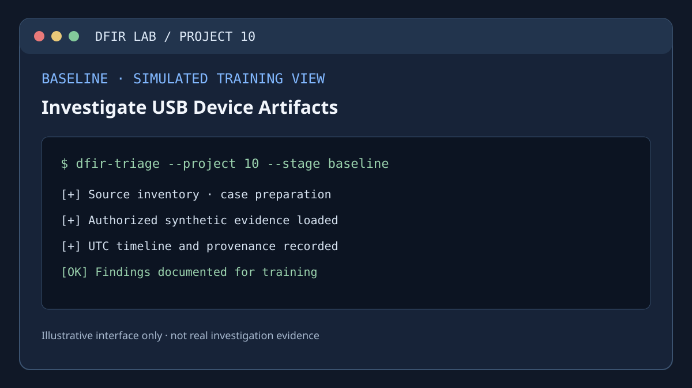
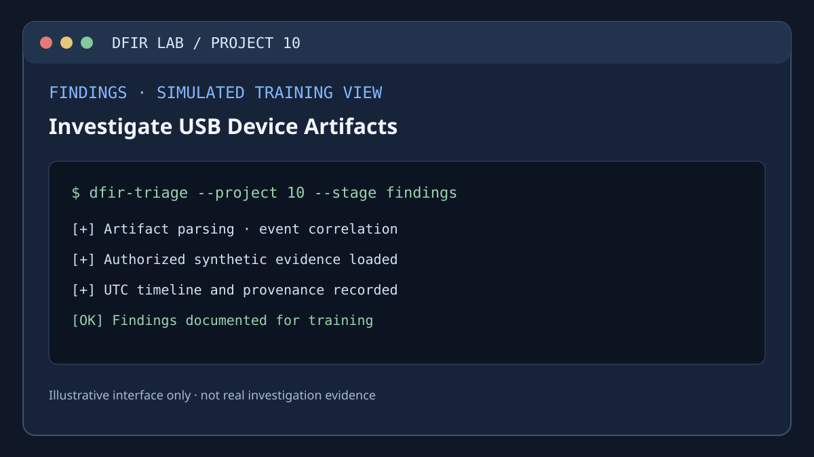
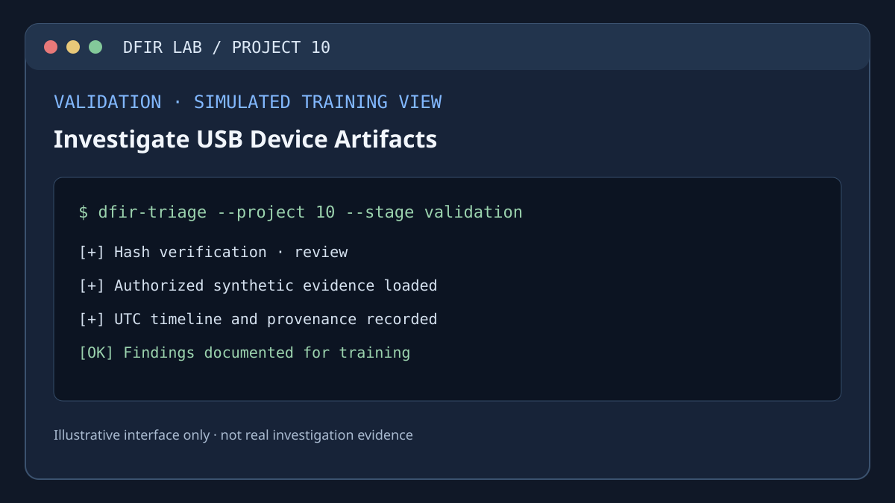

# Project 10: Investigate USB Device Artifacts





## Objective
Develop a repeatable and defensible workflow for investigate usb device artifacts.

## Scope and authorization
Use only systems and evidence you own or are explicitly authorized to examine. Work from verified copies, preserve originals, record UTC timestamps, and protect personal data. These visuals are simulated training illustrations—not real forensic screenshots or case evidence.

## Prerequisites
- Dedicated forensic VM and a case workspace with `evidence/original`, `evidence/working`, `exports`, `notes`, and `reports`.
- Synthetic or explicitly authorized artifacts; sufficient disk space; read-only access to original evidence.
- Tools: Registry Explorer, USBDeview (lab), Windows registry hives.
- Case identifier, examiner, authorization reference, and evidence inventory.

## Lab setup
1. Create the case folders and record host, OS, tool versions, examiner, and UTC time.
2. Place the supplied synthetic artifact in `evidence/original`; calculate SHA-256 and record source metadata.
3. Make a verified working copy and conduct all parsing against that copy.
4. Record every command, tool option, export, and timestamp in the activity log.

## Project workflow
Correlate USBSTOR, MountedDevices, setupapi.dev.log, and device metadata to establish which removable devices were recorded.

### Step 1 — Identify and validate the source
Confirm artifact type, provenance, size, hash, relevant time zone, and parser compatibility. Record any missing or corrupted records before analysis.

### Step 2 — Parse and inspect
Use the listed tools on the working copy. Start with a broad inventory, then filter for the project objective. Preserve raw records alongside parsed output so interpretations can be independently checked.

### Step 3 — Correlate observations
Build a small event table containing UTC timestamp, source artifact, event or record identifier, observation, interpretation, and confidence. Account for time-zone offsets, clock drift, duplicate events, and parser behavior.

### Step 4 — Document results
Capture sanitized output and explain why each artifact is relevant. Distinguish direct evidence from inference; do not identify a human actor based solely on a username, address, or device name.

## Example baseline commands
```bash
date -u
sha256sum /path/to/working-artifact
file /path/to/working-artifact
```

For Windows EVTX exports, a PowerShell triage example is:
```powershell
Get-WinEvent -Path .\Security.evtx -MaxEvents 50 |
  Select-Object TimeCreated, Id, ProviderName, LevelDisplayName, Message
```

For Linux journal exports:
```bash
journalctl --directory=/path/to/export --utc --no-pager
```

Adapt commands to the supplied artifact format; do not run destructive commands or alter the source evidence.

## Expected observations
- Reproducible parser output tied to a source file and hash.
- A concise timeline or event inventory relevant to the objective.
- Explicit notes for missing records, parser limitations, clock assumptions, and uncertainty.
- Sanitized evidence suitable for a portfolio report.

## Findings and risk
Classify observations as confirmed, likely, or inconclusive. Describe affected assets and operational impact. Provide alternative explanations where appropriate and avoid overstating attribution.

## Framework mapping
Relate the investigation to the NIST SP 800-61 incident-handling lifecycle and evidence-preservation practices. Map observed behavior to MITRE ATT&CK only when supported by the artifact. CWE/OWASP mappings are not applicable unless a software weakness is actually identified.

## Remediation
Recommend containment, eradication, recovery, or logging improvements based on validated findings and engagement scope. Preserve relevant evidence before remediation and assign an owner and validation method to each action.

## Validation
1. Re-run the parser against the verified working copy.
2. Confirm exported records can be traced to source paths, event IDs, or offsets.
3. Recalculate hashes for preserved evidence.
4. Have a second reviewer reproduce one key observation.
5. Record discrepancies and limitations.

## Evidence and reporting deliverables
- Authorization and scope record.
- Evidence inventory, chain-of-custody notes, and SHA-256 manifest.
- Tool versions, commands, raw and parsed outputs.
- Timeline/findings table with source references and confidence.
- Executive summary, limitations, and prioritized recommendations.

## Completion checklist
- [ ] Authorization recorded
- [ ] Original preserved and working copy verified
- [ ] UTC timestamps and tool versions recorded
- [ ] Findings traceable to source artifacts
- [ ] Sensitive data redacted
- [ ] Validation and peer review completed
- [ ] Report finalized
