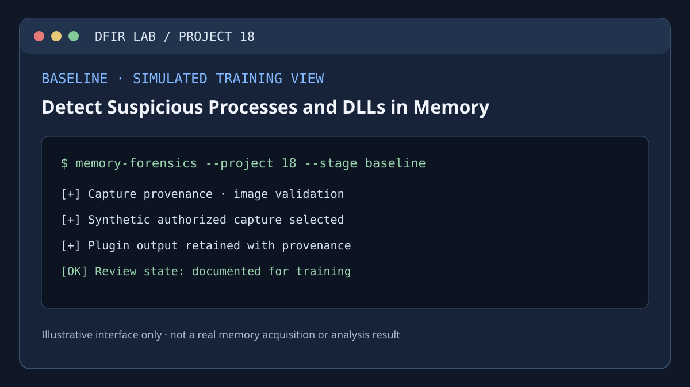
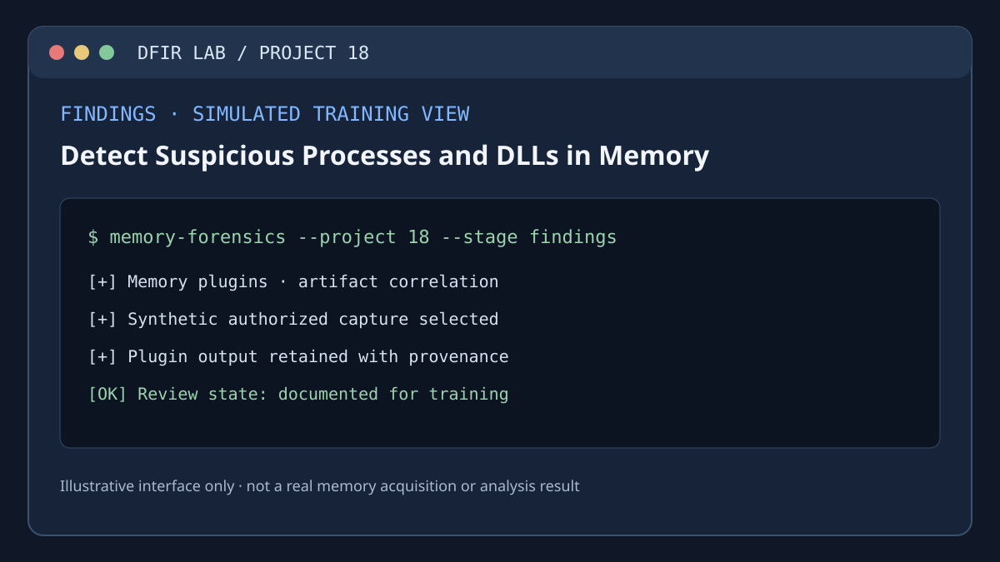
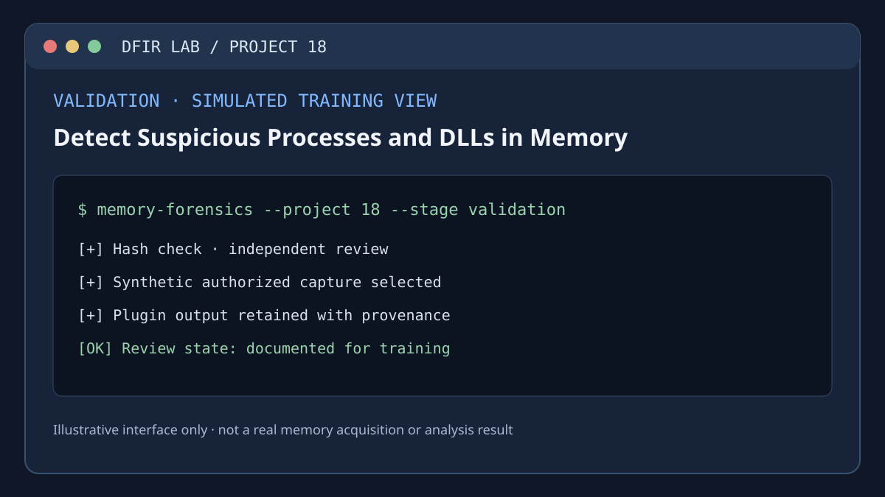

# Project 18: Detect Suspicious Processes and DLLs in Memory





## Objective
Practice detect suspicious processes and dlls in memory using a reproducible, evidence-preserving process.

## Scope and authorization
Use only disposable lab endpoints, synthetic memory images, and logs you own or are authorized to examine. Do not acquire memory from third-party systems. Preserve original captures, work from verified copies, and treat all included illustrations as simulated training visuals—not actual screenshots or case evidence.

## Prerequisites
- Isolated lab VM and adequate storage for memory images.
- Authorized test capture or synthetic training image.
- Tools: Volatility 3, windows.pslist, psscan, dlllist, malfind.
- Case directory, UTC activity log, SHA-256 manifest, and chain-of-custody record.

## Lab setup
1. Record case ID, examiner, authorization, endpoint OS/build, acquisition tool version, and UTC time.
2. Store the original capture in `evidence/original`; hash it immediately.
3. Create a verified working copy in `evidence/working`.
4. Record all tool commands and output paths.

## Project workflow
Compare process listings and scan results in a synthetic memory image, inspect suspicious regions as indicators, and avoid treating heuristics as proof of malware.

### Step 1 — Confirm capture provenance
Record the source endpoint, capture time, acquisition method, tool version, file size, and hash. Note that memory acquisition changes system state to some degree; document this limitation.

### Step 2 — Validate the image
Confirm the file is complete and readable. Record OS/kernel clues and any parser warnings. Do not assume an image is compatible with every plugin.

### Step 3 — Analyze in stages
Begin with system identification and broad process/module/network inventory. Follow up on anomalies using corroborating plugins and independent logs. Preserve raw plugin output.

### Step 4 — Correlate and interpret
Tie each observation to a plugin, process identifier, virtual/physical address, socket tuple, or raw event. Distinguish suspicious indicators from confirmed malicious behavior.

## Example commands
```bash
sha256sum /path/to/memory.raw
file /path/to/memory.raw
vol -f /path/to/memory.raw windows.info
vol -f /path/to/memory.raw windows.pslist
```

Example additional plugin commands (select only those supported by the image):
```bash
vol -f /path/to/memory.raw windows.pstree
vol -f /path/to/memory.raw windows.netscan
```

## Expected observations
- Capture metadata and integrity hashes.
- Plugin output identifying relevant system artifacts.
- Correlation notes with process IDs, timestamps, addresses, or event references.
- Parser errors, missing structures, and other limitations recorded.

## Findings and risk
Classify findings as confirmed, likely, or inconclusive. Explain impact and confidence. A process name, unusual memory region, or network connection alone is not conclusive proof of compromise.

## Framework mapping
Use NIST SP 800-61 incident handling concepts for triage and response. Map observed adversary behavior to MITRE ATT&CK only when supported by multiple artifacts. CWE/OWASP mapping is generally not applicable to memory acquisition itself.

## Remediation
Preserve the capture before containment or cleanup. Recommend endpoint isolation, credential rotation, eradication, or recovery only when justified by validated evidence and within the authorized incident response scope.

## Validation
1. Re-run selected plugins against the verified working copy.
2. Confirm hashes for original and exported artifacts.
3. Correlate at least one observation with an independent log or artifact.
4. Have a reviewer reproduce the key finding and record discrepancies.

## Evidence and reporting deliverables
- Acquisition notes and chain of custody.
- Original and working-copy hashes.
- Tool versions, commands, raw output, and parser warnings.
- Findings table with artifact references and confidence.
- Incident summary, limitations, and response recommendations.

## Completion checklist
- [ ] Authorized lab source used
- [ ] Acquisition limitations documented
- [ ] Original capture preserved and hashed
- [ ] Analysis reproducible from working copy
- [ ] Findings corroborated and confidence-rated
- [ ] Report and evidence inventory completed
