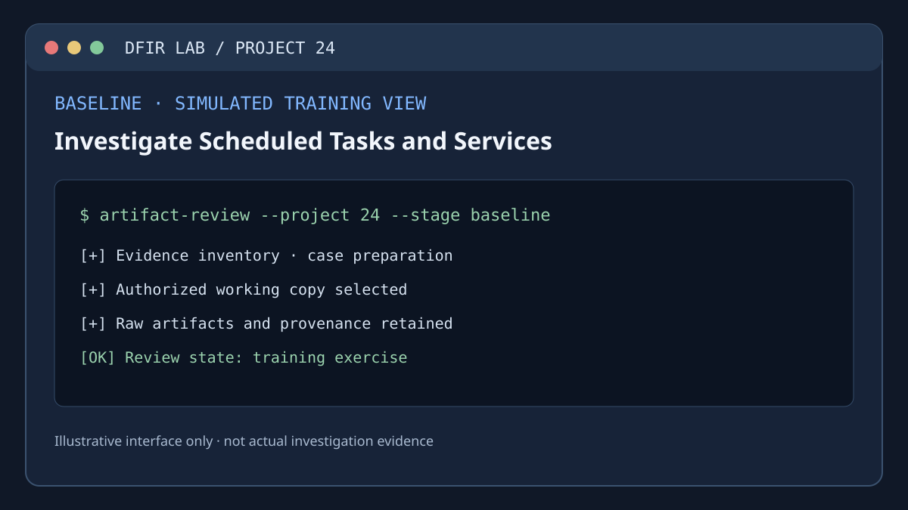
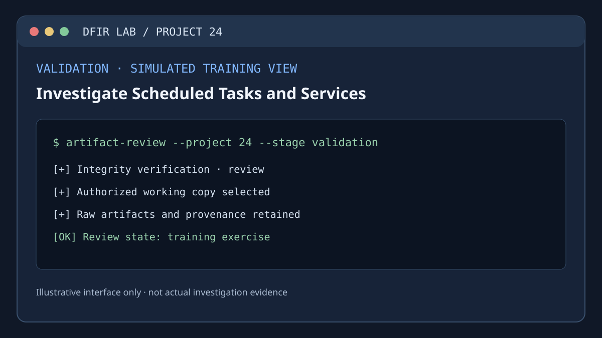

# Project 24: Investigate Scheduled Tasks and Services





## Objective
Conduct investigate scheduled tasks and services and produce a traceable, reproducible incident analysis.

## Scope and authorization
Use only synthetic artifacts, lab captures, or systems explicitly authorized for examination. Preserve original evidence and analyze verified copies. Protect personal data and document UTC timestamps and time-zone assumptions. The illustrations are simulated training visuals, not real forensic screenshots or evidentiary artifacts.

## Prerequisites
- Isolated forensic workstation and adequate storage.
- Authorized evidence image or synthetic data set.
- Tools: Autoruns, RECmd, EvtxECmd, Windows artifacts.
- Case ID, authorization record, chain-of-custody log, and SHA-256 manifest.

## Lab setup
1. Create case folders for originals, working copies, exports, notes, and reports.
2. Record examiner, host details, tool versions, acquisition context, and UTC time.
3. Hash the source evidence, preserve it read-only, and verify a working copy.
4. Save raw parser output separately from interpreted findings.

## Workflow
Correlate scheduled-task XML, service registry keys, task scheduler logs, and execution artifacts to investigate persistence.

### Step 1 — Inventory
Identify the evidence source, format, hash, relevant partitions/artifacts, and parser compatibility. Record errors and missing data before drawing conclusions.

### Step 2 — Parse relevant artifacts
Use the listed tools against the working copy. Preserve raw records and parser versions. Keep a record of command lines, filters, and export locations.

### Step 3 — Correlate
Build an event table with UTC time, source artifact, record/path/offset, observation, interpretation, and confidence. Account for time zone, clock drift, timestamp semantics, and duplicate records.

### Step 4 — Report
Explain what the artifacts demonstrate and what they do not demonstrate. Separate observations from hypotheses and identify alternative explanations.

## Example commands
```bash
date -u
sha256sum /path/to/working-image
file /path/to/working-image
```

A general Windows event export inspection example:
```powershell
Get-WinEvent -Path .\System.evtx -MaxEvents 100 |
  Select-Object TimeCreated, Id, ProviderName, Message
```

Use only commands appropriate to your artifact and environment. Avoid writes to the original evidence.

## Expected observations
- Artifact inventory and parser output linked to the source.
- A timeline or structured record set supporting the objective.
- Hashes, tool versions, and collection limitations.
- A concise set of findings with confidence and corroboration.

## Findings and risk
Rate each observation confirmed, likely, or inconclusive. Describe impact and affected assets. Do not infer user intent or actor identity from a single artifact.

## Framework mapping
Align investigation steps to NIST SP 800-61 incident handling. Map behaviors to MITRE ATT&CK only where evidence supports the technique. CWE/OWASP mappings apply only if a software weakness is identified.

## Remediation
Preserve evidence before containment or remediation. Recommend actions proportionate to confirmed findings, with owner, priority, and a measurable validation step.

## Validation
1. Re-run the parser on the verified working copy.
2. Confirm each exported artifact is traceable to a source record.
3. Recalculate evidence hashes and compare with the manifest.
4. Obtain independent review of at least one key finding.
5. Document unresolved inconsistencies.

## Deliverables
- Scope and authorization record.
- Evidence inventory and chain of custody.
- SHA-256 manifest, tool versions, commands, and raw outputs.
- Timeline/findings table with source references and confidence.
- Executive summary, limitations, and recommendations.

## Completion checklist
- [ ] Authorized evidence only
- [ ] Original preserved and hashes recorded
- [ ] Working copy verified
- [ ] Time normalization documented
- [ ] Findings traceable and confidence-rated
- [ ] Peer review completed
- [ ] Sensitive data redacted from report
