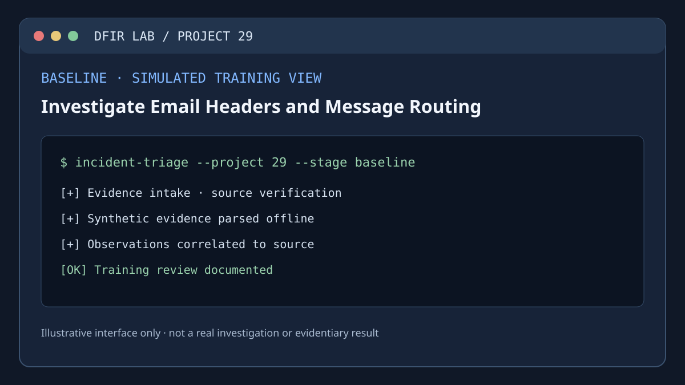
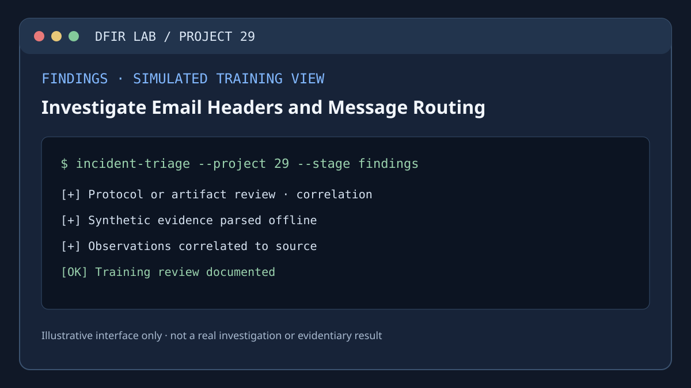
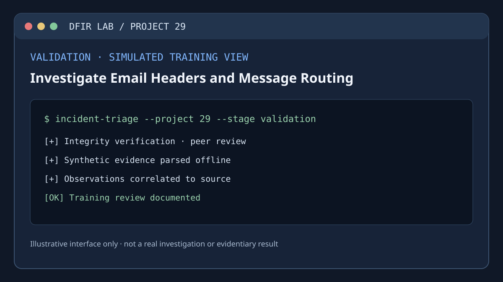

# Project 29: Investigate Email Headers and Message Routing





## Objective
Perform investigate email headers and message routing using a documented, reproducible, and evidence-preserving workflow.

## Scope and authorization
Use synthetic captures and messages or evidence from systems you own or are authorized to investigate. Do not interact with external targets, execute suspicious content, or expose real personal data. Preserve originals and analyze verified copies. All images are simulated training visuals—not actual case screenshots or evidence.

## Prerequisites
- Isolated analysis VM with sufficient storage.
- Synthetic PCAP, logs, email, or inert document samples as appropriate.
- Tools: Thunderbird (offline), header analyzers, Python email.
- Case notes, UTC timeline, SHA-256 manifest, and chain-of-custody log.

## Lab setup
1. Record authorization, case ID, examiner, source, tool versions, and UTC time.
2. Store original evidence read-only and calculate SHA-256.
3. Create a verified working copy for parsing.
4. Save raw output, filtered output, and analyst notes separately.

## Project workflow
Parse a synthetic email with full headers, trace Received hops, inspect SPF/DKIM/DMARC results as recorded, and identify spoofing indicators.

### Step 1 — Establish provenance
Record source, file type, size, hash, capture context, and time-zone assumptions. Note whether the capture is complete and whether encryption or missing telemetry limits visibility.

### Step 2 — Parse safely
Use the listed tools against the working copy. Begin with metadata and broad inventory, then apply filters relevant to the incident question. Do not execute files or follow links from evidence.

### Step 3 — Correlate
Correlate records across sources using UTC timestamps, message IDs, five-tuples, DNS transaction IDs, or other stable identifiers. Record clock drift and uncertainty.

### Step 4 — Interpret
Separate observable facts from inference. Explain what the data cannot establish (for example, a source IP does not necessarily identify a human or device owner).

## Example commands
```bash
sha256sum /path/to/authorized-artifact
file /path/to/authorized-artifact
tshark -r /path/to/lab.pcap -q -z conv,ip
```

For static Office document inspection:
```bash
oleid sample.doc
olevba sample.doc
```

Use inert samples only. Never enable macros, execute embedded content, or open suspicious documents on a production endpoint.

## Expected observations
- Hash-verified evidence and a repeatable parsing record.
- Extracted metadata relevant to the investigation question.
- Correlation table with source references and UTC timestamps.
- Documented blind spots, encryption, missing logs, and parser limitations.

## Findings and risk
Classify each finding as confirmed, likely, or inconclusive. Explain impact and confidence, include corroborating evidence, and list alternative explanations. Do not claim attribution from an isolated header, IP address, domain, or event.

## Framework mapping
Relate response actions to NIST SP 800-61. Map network or adversary behaviors to MITRE ATT&CK only when supported by evidence. CWE/OWASP applies only where an actual software weakness is established.

## Remediation
Recommend containment, blocking, account protection, mail authentication, endpoint controls, or monitoring improvements as supported by findings and authorized scope. Preserve evidence before making changes.

## Validation
1. Re-run parsing on the verified working copy.
2. Confirm extracted records can be traced to source offsets, packets, headers, or event IDs.
3. Recalculate hashes for preserved evidence.
4. Independently reproduce one key finding.
5. Record any unresolved ambiguity.

## Deliverables
- Authorization and evidence inventory.
- Chain-of-custody record and SHA-256 manifest.
- Tool versions, commands, and raw/parsed output.
- Timeline and findings table with confidence.
- Executive summary, limitations, and prioritized response actions.

## Completion checklist
- [ ] Authorized synthetic/lab evidence only
- [ ] Original evidence preserved and hashed
- [ ] Safe static/read-only analysis performed
- [ ] Findings traceable to source records
- [ ] Time-zone assumptions and limitations documented
- [ ] Independent validation completed
- [ ] Sensitive information redacted
