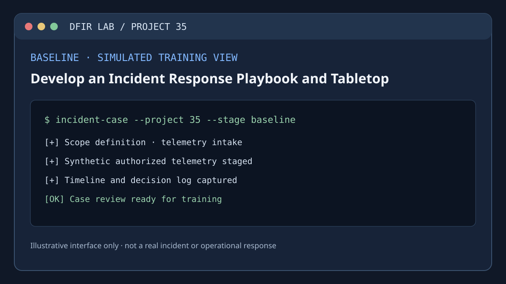
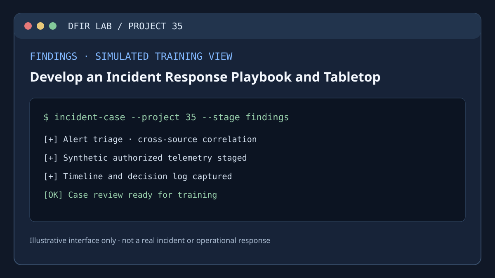
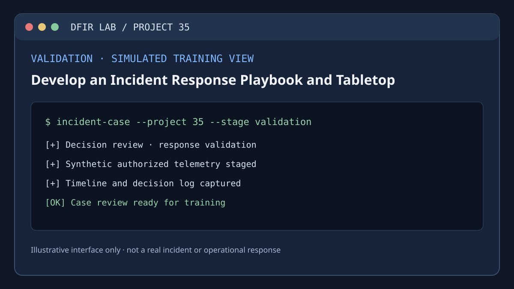

# Project 35: Develop an Incident Response Playbook and Tabletop





## Objective
Build and validate a repeatable incident investigation workflow for develop an incident response playbook and tabletop.

## Scope and authorization
Use synthetic telemetry, lab endpoints, and authorized exports only. Do not access customer or third-party cloud tenants without written authorization. Preserve source exports, redact sensitive information, and document UTC time assumptions. The three illustrations are simulated training visuals, not screenshots from actual tools or real incidents.

## Prerequisites
- Isolated lab environment and case workspace.
- Synthetic event, endpoint, network, or cloud audit data.
- Tools: NIST SP 800-61, MITRE ATT&CK, case templates.
- Written scope, case ID, examiner, evidence manifest, and chain-of-custody notes.

## Lab setup
1. Define investigation questions, in-scope assets, data sources, and time window.
2. Export or stage synthetic telemetry; preserve original exports read-only.
3. Hash source files and create verified working copies.
4. Record tool versions, time zones, field mappings, and known collection gaps.

## Workflow
Design and run a tabletop scenario with injects, decision points, evidence requirements, escalation paths, and measurable after-action improvements.

### Step 1 — Define hypotheses and scope
Write testable questions and list data sources that can confirm or disprove each hypothesis. Identify out-of-scope systems and escalation contacts.

### Step 2 — Ingest and normalize
Load authorized exports into the analysis environment. Normalize timestamps to UTC while retaining original values. Preserve source event IDs, host IDs, process identifiers, and network tuples.

### Step 3 — Investigate and correlate
Review alerts in context, pivot across data sources, and build an evidence timeline. Record both supporting and contradictory evidence. Do not treat a detection rule match as proof by itself.

### Step 4 — Decide and document
Record severity, confidence, affected assets, containment rationale, owner, and next action. Distinguish simulated exercise injects from observed telemetry.

## Example workflow commands
```bash
sha256sum evidence/original/*
date -u
find evidence/working -type f -maxdepth 3 -print
```

Use platform-specific export and query syntax only against the synthetic lab data. Avoid executing malware or taking disruptive actions against production systems.

## Expected observations
- Evidence source inventory and verified hashes.
- Normalized event timeline with traceable source identifiers.
- Correlated findings with confidence and alternative explanations.
- Decision log, response actions, and identified telemetry gaps.

## Findings and risk
Classify findings as confirmed, likely, or inconclusive. Describe business impact, affected systems, and evidence supporting severity. Record uncertainty and potential false positives.

## Framework mapping
Align incident workflow to NIST SP 800-61. Use MITRE ATT&CK to describe supported adversary behaviors. Use CIS Controls or NIST CSF for control-gap recommendations where appropriate. Do not force CWE/OWASP mappings unless a software weakness is in scope.

## Remediation and response
Recommend proportionate containment, eradication, recovery, and hardening actions. Preserve evidence before changes. Assign each action an owner, priority, due date, and validation criterion.

## Validation
1. Reproduce at least one finding from the original source export.
2. Confirm time normalization and source identifiers.
3. Validate hashes and chain-of-custody entries.
4. Review the decision log with a second analyst.
5. Record lessons learned and remaining gaps.

## Deliverables
- Investigation scope and questions.
- Evidence inventory, hashes, and custody record.
- Tool/query log and normalized timeline.
- Findings and severity rationale.
- Decision/action log, limitations, and after-action recommendations.

## Completion checklist
- [ ] Scope and authorization documented
- [ ] Evidence preserved and hashed
- [ ] Telemetry normalized and correlated
- [ ] Findings supported and confidence-rated
- [ ] Response decisions justified
- [ ] Independent review completed
- [ ] Lessons learned captured
