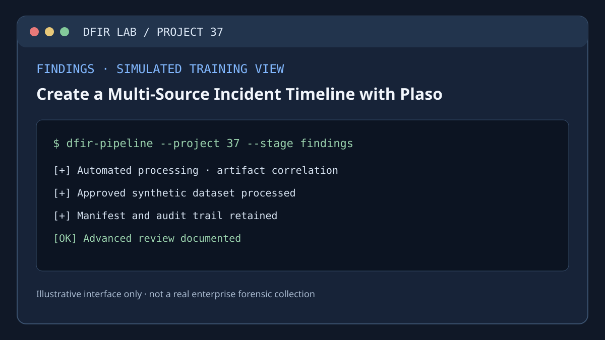
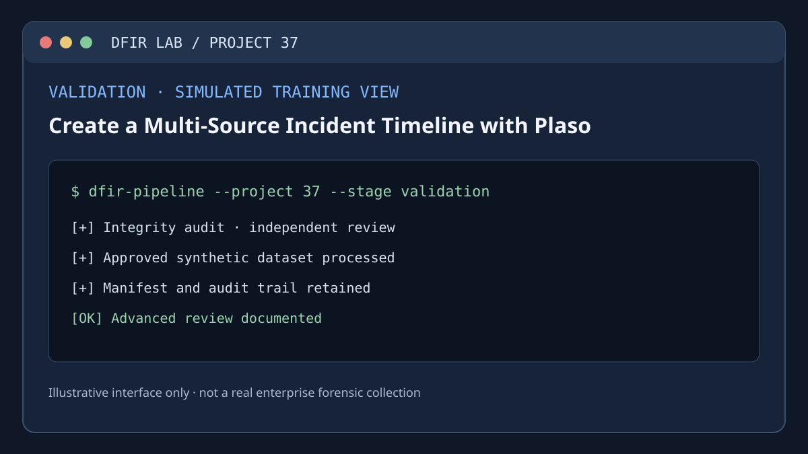

# Project 37: Create a Multi-Source Incident Timeline with Plaso





## Objective
Implement an advanced, auditable DFIR workflow for create a multi-source incident timeline with plaso.

## Scope and authorization
Use only synthetic evidence or systems for which written authorization exists. Collection must be limited to approved artifacts and endpoints. Do not extract, reveal, or reuse credentials or secrets. Preserve original evidence and protect sensitive data. The illustrations are simulated training visuals, not real screenshots or evidence.

## Prerequisites
- Isolated lab environment with dedicated evidence storage.
- Synthetic endpoint, memory, event, or disk artifacts.
- Tools: Plaso/log2timeline, psort, Timesketch.
- Approved collection scope, case ID, examiner, evidence manifest, and chain-of-custody log.

## Lab setup
1. Define exact systems, artifact classes, collection window, and prohibited actions.
2. Record authorization, examiner, UTC time, tool versions, and endpoint identifiers.
3. Stage authorized synthetic artifacts; hash and preserve originals.
4. Create verified working copies and segregate raw output from derived data.

## Project workflow
Process a synthetic multi-source evidence set, normalize timestamps, export timeline events, and document parser coverage and clock drift.

### Step 1 — Design collection or analysis plan
Document the objective, data sources, expected output, privacy considerations, and failure handling. Use least privilege and avoid unnecessary collection.

### Step 2 — Execute controlled processing
Run the tools only on the approved lab dataset or endpoint. Record command lines, configuration, timestamps, exit codes, and output hashes. Do not modify source evidence.

### Step 3 — Correlate and assess
Correlate artifacts using stable identifiers and normalized UTC time. Validate suspicious findings with independent evidence; preserve contradictory observations and false-positive analysis.

### Step 4 — Package results
Generate a manifest, case notes, sanitized evidence excerpts, and a report. Ensure each derived artifact points to its source and transformation steps.

## Example integrity and inventory commands
```bash
date -u
find evidence/working -type f -print0 | sort -z | xargs -0 sha256sum
```

Example JSON manifest fields:
```json
{
  "case_id": "DFIR-LAB-CASE-001",
  "examiner": "Authorized Lab Analyst",
  "timestamp_utc": "YYYY-MM-DDTHH:MM:SSZ",
  "source_artifact": "synthetic-lab-artifact",
  "sha256": "record-the-actual-64-character-hash",
  "tool_versions": ["record exact versions"]
}
```

## Expected observations
- Controlled collection or parsing with auditable logs.
- Integrity manifest and traceable transformations.
- Correlated findings with confidence and limitations.
- Privacy-aware outputs without exposed credentials or unnecessary personal data.

## Findings and risk
Rate findings confirmed, likely, or inconclusive. Explain affected assets and business impact. Avoid treating tool heuristics or a single artifact as conclusive attribution.

## Framework mapping
Use NIST SP 800-61 for incident handling, NIST SP 800-86 for forensic integration, and MITRE ATT&CK for supported adversary behaviors. Apply CIS Controls/NIST CSF to control improvements. CWE/OWASP is relevant only when a software weakness is established.

## Remediation
Preserve evidence before containment. Recommend actions that are proportionate, authorized, and supported by evidence. Include owners, priorities, dependencies, and measurable validation criteria.

## Validation
1. Re-run the pipeline or parser against the same verified dataset.
2. Compare hashes and manifest entries.
3. Confirm source-to-output traceability and reproduce a selected finding.
4. Review collection scope and privacy handling.
5. Have a second analyst review results and limitations.

## Deliverables
- Approved scope and collection plan.
- Chain-of-custody record and evidence manifest.
- Tool configuration, versions, commands, logs, and hashes.
- Timeline and findings with source references and confidence.
- Sanitized report, limitations, and recommendations.

## Completion checklist
- [ ] Exact scope and authorization approved
- [ ] Collection minimized and documented
- [ ] Original evidence preserved
- [ ] Hashes and derived outputs traceable
- [ ] Secrets and personal data protected
- [ ] Findings independently validated
- [ ] Report reviewed and finalized
