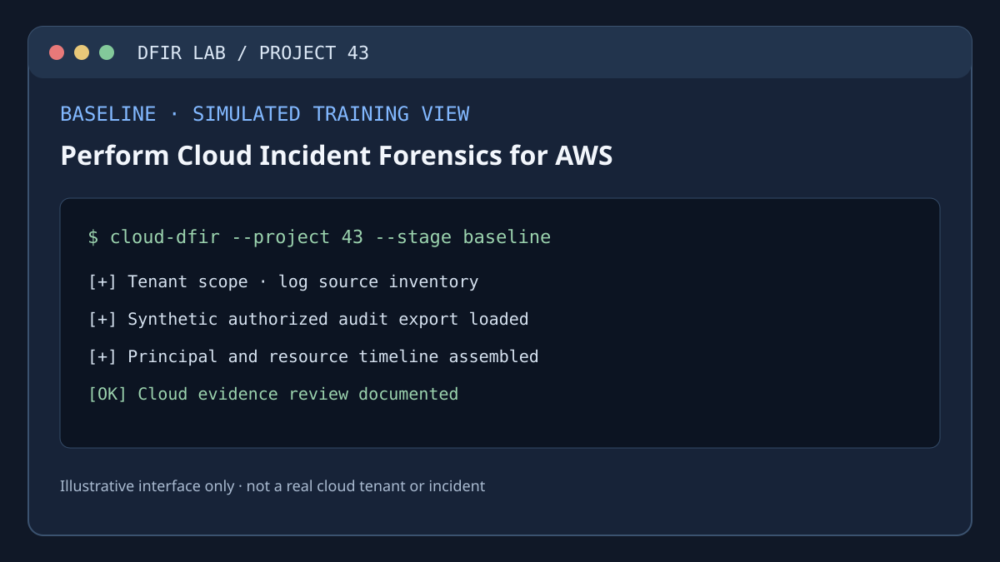
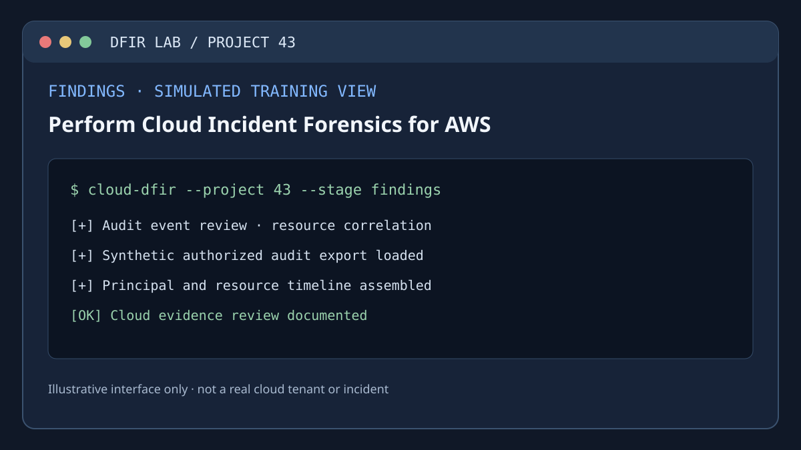
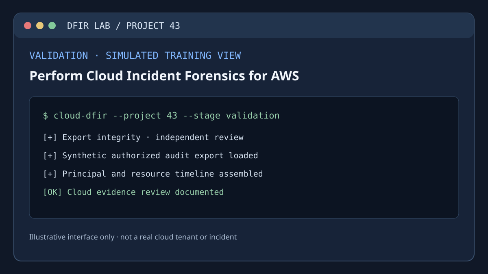

# Project 43: Perform Cloud Incident Forensics for AWS





## Objective
Perform perform cloud incident forensics for aws using authorized cloud or infrastructure evidence and a defensible investigation process.

## Scope and authorization
Use synthetic cloud audit exports and lab infrastructure, or a tenant explicitly authorized in writing. Do not access a third-party tenant, enumerate unrelated resources, or change production configurations. Preserve source exports, protect identity data, and document retention gaps. Illustrations are simulated training visuals, not real cloud console screenshots or evidence.

## Prerequisites
- Isolated lab tenant or synthetic export bundle.
- Read-only access to approved audit and security logs.
- Tools: AWS CloudTrail exports, GuardDuty findings, S3 access logs, Athena.
- Case ID, authorization record, UTC timeline, SHA-256 manifest, and chain-of-custody log.

## Lab setup
1. Define tenant/account/project IDs, in-scope resources, time window, and approved log sources.
2. Export only the required synthetic or authorized logs.
3. Preserve original exports and calculate SHA-256 hashes.
4. Create verified working copies; record API, export, and parser versions.

## Project workflow
Investigate synthetic AWS audit and detection exports, build a timeline, identify affected resources, and document retention and visibility limits.

### Step 1 — Establish cloud evidence context
Record tenant/account/project identifier, region, log source, export time, retention period, collection principal, and query/filter parameters. Note any disabled logging or known gaps.

### Step 2 — Parse and normalize
Load exported records into a local analysis workspace. Normalize event timestamps to UTC while preserving raw values. Retain principal IDs, resource IDs, request IDs, event names, and source addresses where present.

### Step 3 — Scope and correlate
Build a timeline across identity, control-plane, network, and detection sources. Correlate using request IDs, principal identifiers, resource IDs, and time windows. Avoid assuming that an IP or service principal maps directly to a human.

### Step 4 — Assess impact
Identify affected resources and actions, validate alerts against raw audit events, and document uncertainty. Keep hypotheses separate from confirmed observations.

## Example integrity commands
```bash
sha256sum evidence/original/*
date -u
jq '.[0]' evidence/working/cloud-audit.json
```

Use provider-specific query syntax only on approved exported logs. Keep queries read-only and retain the exact query text and result metadata.

## Expected observations
- Verified cloud log exports and documented provenance.
- Timeline of relevant identity and resource events.
- Findings tied to request IDs, event names, principals, and resource identifiers.
- Retention, logging, and parser limitations recorded.

## Findings and risk
Classify observations confirmed, likely, or inconclusive. Explain affected resources, privilege or data exposure implications, and confidence. Corroborate high-impact findings with independent sources.

## Framework mapping
Use NIST SP 800-61 and NIST SP 800-86 for response and forensic handling. Map supported behaviors to MITRE ATT&CK Cloud techniques. Use CIS cloud benchmarks or provider security foundations for control-gap recommendations.

## Remediation
Preserve relevant logs before changes. Recommend scoped identity revocation, key rotation, resource isolation, policy correction, or logging improvements only when supported and approved. Define owner and validation method.

## Validation
1. Re-run analysis against the same verified export.
2. Confirm event provenance and query parameters.
3. Compare source hashes with the evidence manifest.
4. Corroborate one finding from an independent log source.
5. Review data minimization and redaction.

## Deliverables
- Cloud scope and authorization record.
- Evidence inventory, export metadata, and SHA-256 manifest.
- Queries, parser versions, and raw/normalized output.
- Timeline, findings, affected resource list, and confidence.
- Executive summary, retention gaps, and remediation plan.

## Completion checklist
- [ ] Tenant/account scope explicitly authorized
- [ ] Read-only evidence collection
- [ ] Original exports preserved and hashed
- [ ] Identity and resource IDs correlated
- [ ] Logging/retention limitations documented
- [ ] Findings validated and redacted
- [ ] Report reviewed
