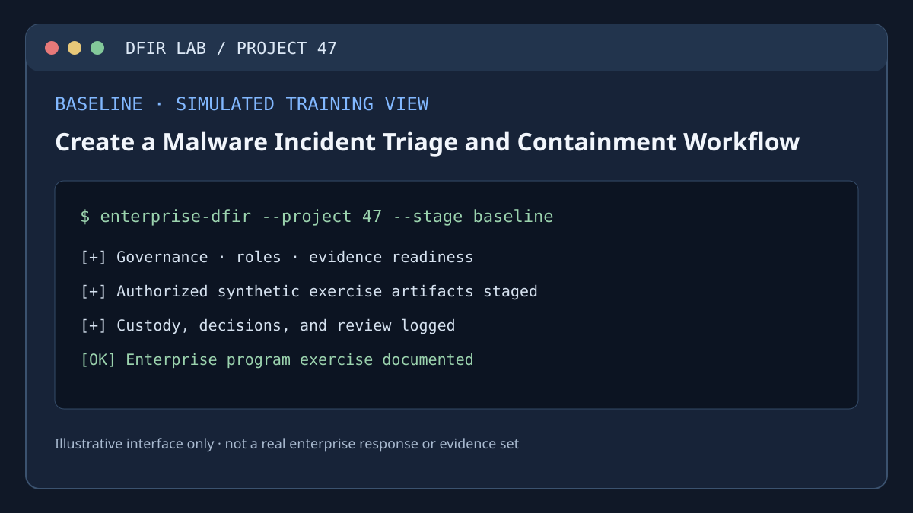
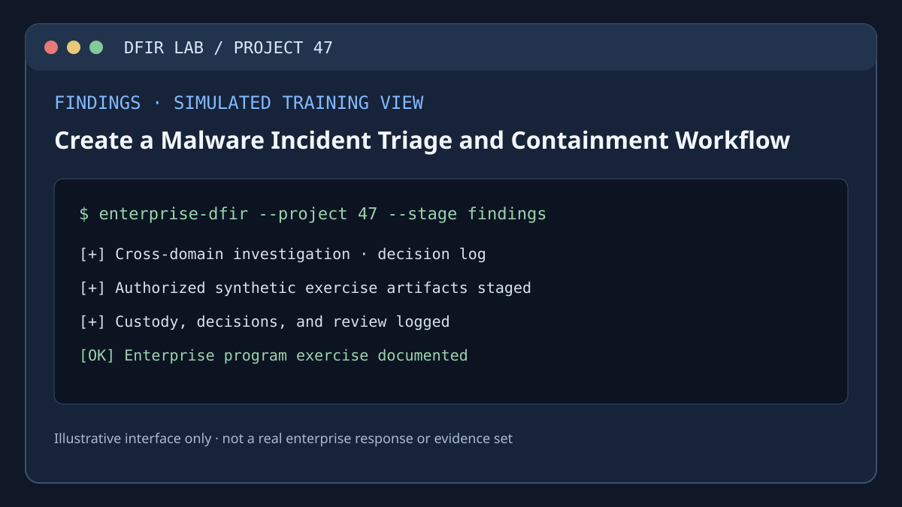

# Project 47: Create a Malware Incident Triage and Containment Workflow





## Objective
Design and execute an advanced DFIR capability for create a malware incident triage and containment workflow, with measurable evidence integrity, operational governance, and review.

## Scope and authorization
This is a controlled portfolio exercise. Use synthetic evidence, lab systems, and authorized organizational records only. Any real enterprise engagement requires written authorization, defined data handling, privacy review, and approved response authority. Preserve original evidence and document custody. These illustrations are simulated training visuals, not actual enterprise console screenshots or incident evidence.

## Prerequisites
- Isolated lab environment and case-management workspace.
- Synthetic multi-source telemetry or approved evidence bundle.
- Tools and references: Velociraptor, YARA (static), EDR exports, NIST SP 800-61.
- Documented scope, roles, escalation contacts, retention rules, and evidence-handling procedure.

## Lab setup
1. Define business scenario, systems, data sources, time window, and exercise objectives.
2. Assign incident commander, forensic lead, endpoint/network/cloud analysts, legal/privacy liaison, and communications owner as appropriate.
3. Stage synthetic evidence and hash all source artifacts.
4. Establish an activity log, decision log, evidence inventory, and UTC timeline.

## Project workflow
Build a safe malware incident workflow around inert indicators and synthetic telemetry, including evidence preservation, scoping, containment decisions, and recovery validation.

### Step 1 — Governance and preparation
Document authority to collect, roles and responsibilities, communications channels, evidence storage, access control, retention, and escalation thresholds. Define what actions require incident commander or legal approval.

### Step 2 — Evidence collection and preservation
Collect only approved artifacts using documented methods. Preserve originals, verify working copies, record hashes, and maintain custody events. Minimize personal data and restrict access to need-to-know roles.

### Step 3 — Investigation and decision-making
Correlate identity, endpoint, network, application, and cloud evidence. Maintain hypotheses and confidence ratings. Record containment decisions, rationale, approver, time, and expected operational impact.

### Step 4 — Recovery and lessons learned
Validate recovery using measurable criteria, preserve post-incident evidence, conduct an after-action review, and convert lessons into prioritized program improvements.

## Example evidence manifest
```json
{
  "case_id": "DFIR-ENTERPRISE-EXERCISE-001",
  "evidence_id": "EV-0001",
  "source": "synthetic-authorized-source",
  "collected_at_utc": "YYYY-MM-DDTHH:MM:SSZ",
  "collector_role": "Forensic Analyst",
  "sha256": "record-the-actual-64-character-hash",
  "handling": "read-only-original; verified-working-copy"
}
```

## Expected observations
- Complete roles, governance, and escalation record.
- Traceable evidence inventory, custody events, and integrity hashes.
- Correlated timeline and confidence-rated findings.
- Documented decisions, recovery validation, and measurable improvements.

## Findings and risk
Assess technical severity and business impact separately. State affected assets, evidence strength, confidence, and uncertainty. Avoid unsupported attribution and distinguish exercise injects from observations.

## Framework mapping
Use NIST SP 800-61 for incident response, NIST SP 800-86 for forensic integration, NIST CSF for program outcomes, and MITRE ATT&CK for supported adversary behaviors. Map control improvements to CIS Controls where useful. Do not force CWE/OWASP mappings unless an application weakness is in scope.

## Remediation and program improvement
Prioritize actions by risk and business impact. Assign owners, target dates, dependencies, and measurable acceptance criteria. Include evidence retention, logging coverage, analyst training, tabletop cadence, and recovery testing.

## Validation
1. Verify evidence hashes and custody completeness.
2. Reproduce selected findings from preserved source data.
3. Test response decision and escalation paths.
4. Validate recovery against documented service criteria.
5. Review program metrics and confirm assigned improvement actions.

## Deliverables
- Governance and authorization pack.
- Roles/RACI and escalation matrix.
- Evidence inventory, chain-of-custody log, and hash manifest.
- Timeline, findings, decisions, and response report.
- Recovery validation and after-action report.
- Prioritized DFIR program roadmap and metrics.

## Completion checklist
- [ ] Authorization, scope, and roles documented
- [ ] Evidence preserved, hashed, and access-controlled
- [ ] Timeline and findings traceable
- [ ] Decisions and approvals recorded
- [ ] Recovery validated
- [ ] After-action review completed
- [ ] Program improvements assigned and measurable
